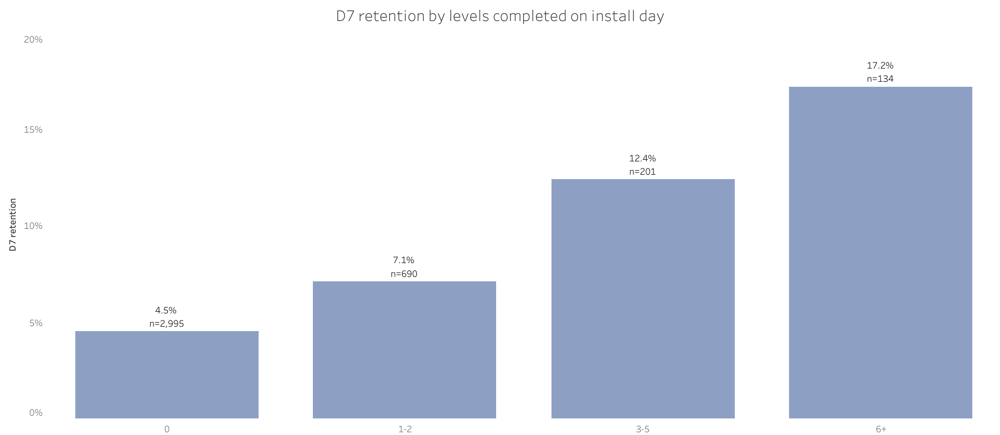

# What Makes Mobile Players Come Back?

Real Google Analytics 4 data from the mobile game *Flood-It!*, [public in BigQuery](https://developers.google.com/analytics/bigquery/app-gaming-demo-dataset) (`firebase-public-project.analytics_153293282`).

## Question

An app pays for ads to get installs, but most players play once and never return. Ad platforms (Google, Meta, TikTok) can be told to find players who take a specific action in the app. The question: **which action on the first day best predicts that a player is still playing a week later?**

```
install (day 0)  →  action on day 0  →  returns on day 7?
```



## Data

| | |
|---|---|
| Source | `firebase-public-project.analytics_153293282.events_*` |
| Period | 114 days (2018) |
| Users in export | 15,175 |
| New installs analysed | 4,319 (4,020 with a full 7-day window) |

## What I Did

1. **Checked revenue first.** Only 27 purchases ($24.89) in 114 days, too little for LTV or ROAS. So I changed the question from "which players pay" to "which players stay".
2. **Built one row per installed player** ([`mart_user`](02_mart_user.sql)): install date, country, OS, return on day 1 and day 7, and what they did on day 0.
3. **Compared day-0 actions** by how much they raise day-7 return, and how often they happen.
4. **Compared countries and OS** on day-1 and day-7 return.

## Findings

- **3+ levels on day 0 → 3× more likely to return:** 14.3% vs 5.0% on day 7.
- **But it's too rare to optimize ads for:** ~22 times a week, while ad platforms need ~50.
- **"Posted a score" is the practical choice:** almost the same effect (7.8% vs 2.8%), ~160 times a week, and covers 82% of players who return on day 7.
- **Country matters more than OS:** Android India returns on day 7 at 3.1%, Android US at 8.4%. For the same value, an Indian install should cost at most ~37% of a US one.

## Data Checks

- **Most users installed before the data starts:** 72% have no install event → excluded, not counted as new.
- **Installs match the raw data exactly:** 4,319 = 4,319. 3 reinstalls, negligible.
- **No paid traffic to analyse:** 67% `(direct)`, 31% Google Play organic, 1 paid install → I compared country × OS instead of ad sources.
- **Same source written two ways** (`google` / `Google`) → normalized with `LOWER()`.
- **Day-7 return counted only for players installed 7+ days before the data ends,** so recent installs don't look worse than they are.

## Limitations

- Correlation, not causation: engaged players both post scores and come back.
- One casual game, 2018, data obfuscated by Google. Patterns, not benchmarks.
- No ad spend or revenue, so no ROAS.

## How to Run

1. Open BigQuery (free sandbox works) and create a dataset `floodit` in location **US**.
2. In each SQL file, replace `YOUR_PROJECT` with your own project ID.
3. Run the files in order: `01_data_checks` → `02_mart_user` → `03_validation` → `04_analysis`.

## AI Usage

- **Claude:** drafted the SQL and chart script.
- **Me:** ran every query in BigQuery, fixed the setup error (`Dataset ... was not found in location US`: the dataset had to be created in US, where the public data lives), and checked every number against the query results.
- **Plan changed by the data:** the first plan was revenue and break-even CPI. My first check showed only $24.89 of revenue, so I switched to retention.
- **AI mistake caught:** Claude estimated ~1,100 users with more than one traffic source. My coverage query showed 15,175 users, which puts the real number at 26.

## Stack

`SQL` · `Google BigQuery` · `Python (matplotlib)`
